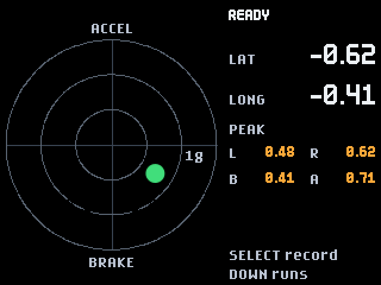

# AutoX

Measure cornering, braking and acceleration forces and log your autocross runs.



## Usage

Mount the badge firmly in the car at any angle, for example in a phone mount. It must not swing on a lanyard. Grip it by the clear case around the screen, not by the touch-pad strip below it. Touching **BACK** (the upper round pad) resets the peaks, **SELECT** (the lower round pad) starts or stops a run, and **MENU** (the left slanted oval) recalibrates. On first launch the app calibrates in two steps:

1. **Level:** stop the car and keep still for about a second while the badge measures gravity.
2. **Forward:** drive forward gently in a straight line so the badge learns which way is forward.

Calibration is saved. Press **MENU** to recalibrate after moving the badge to a different mount or position.

### Staying level

Mounts can sag or slip, which makes part of gravity read as braking or acceleration. AutoX re-levels itself whenever the car has been stopped for about a second on the live screen, for example at the start line. It uses the gyroscope to tell a stopped car from steady cornering. The status above the hints shows:

| Status | Meaning |
| --- | --- |
| `LEVEL OK` (green) | Re-levelled while stopped and ready to record |
| `STOP TO LEVEL` | Not checked yet; stop for a second |
| `TILTED 12 DEG` (amber) | During a run, the badge has tipped since the run started; readings may be off |
| `MOVED: PRESS MENU` (red) | The badge has moved more than 30°, so recalibrate |

Calibration never changes during a recording, so each run stays consistent.

On the live screen the green ball shows the force you feel, like a ball rolling in a bowl: it moves down when accelerating, up when braking, right in a left turn and left in a right turn. The rings mark 0.5, 1.0 and 1.5 g. The panel shows live lateral and longitudinal g and the peaks in each direction.

| Control | Action |
| --- | --- |
| SELECT | Start or stop recording a run |
| BACK | Reset the peaks |
| MENU | Recalibrate |
| DOWN | Show saved runs (UP/DOWN to scroll, BACK to return) |

Runs stop automatically after 3 minutes. The badge keeps up to 40 runs and deletes the oldest when storage runs low.

## Getting runs onto a computer

Connect the badge over USB and run the export script from the repository root. It needs [`mpremote`](https://docs.micropython.org/en/latest/reference/mpremote.html):

```bash
python3 tools/autox/export.py            # copy runs to ./autox-runs as CSV
python3 tools/autox/export.py --delete   # also remove them from the badge
```

Each CSV has the columns `t_s, lat_g, long_g, ax_g, ay_g, az_g`. `lat_g` is positive when turning left and `long_g` is positive when accelerating.

## Notes

- The sensor's range is ±2 g, which covers normal autocross loads (about 1–1.5 g).
- Samples are taken once per frame, about 44 per second while on the live screen.
- There is no GPS, so the app shows forces only, not speed, position or lap times.
- The screen runs at full brightness while the app is open, for reading in a car. Your brightness from Settings comes back when you leave the app.
- No Wi-Fi or `secrets.py` settings are needed.
