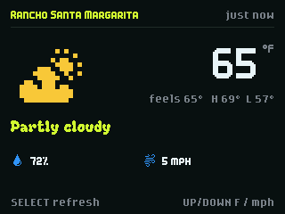

# Weather

Show the current weather where you are, with temperature, conditions, humidity and wind.



## Usage

Configure Wi-Fi in Settings first. The app finds your location from your IP address, then shows the current temperature, what it feels like, today's high and low, conditions, humidity and wind speed. It refreshes every 10 minutes.

| Control | Action |
| --- | --- |
| SELECT | Fetch the weather again now |
| UP / DOWN | Cycle units: °F + mph, °C + mph, °C + km/h (remembered) |

Units start as °F + mph in the US and °C + km/h elsewhere.

## Setting the location

IP location can be a town or two off. To pin it, add `WEATHER_LOCATION` to `secrets.py` in any of these forms:

```python
WEATHER_LOCATION = "Paris"
WEATHER_LOCATION = ("London", "GB")                  # city, country code
WEATHER_LOCATION = {"city": "Tokyo", "country": "JP"}
WEATHER_LOCATION = (37.7749, -122.4194, "San Francisco", "US")
WEATHER_LOCATION = {"lat": 37.7749, "lon": -122.4194, "name": "SF", "country": "US"}
```

## Data sources

Weather comes from [Open-Meteo](https://open-meteo.com/), with [wttr.in](https://wttr.in/) as a fallback when Open-Meteo doesn't answer. Location comes from [ipapi.co](https://ipapi.co/) or [ipwho.is](https://ipwho.is/), and city names are looked up with Open-Meteo's geocoding API. None of them need a key or an account.
